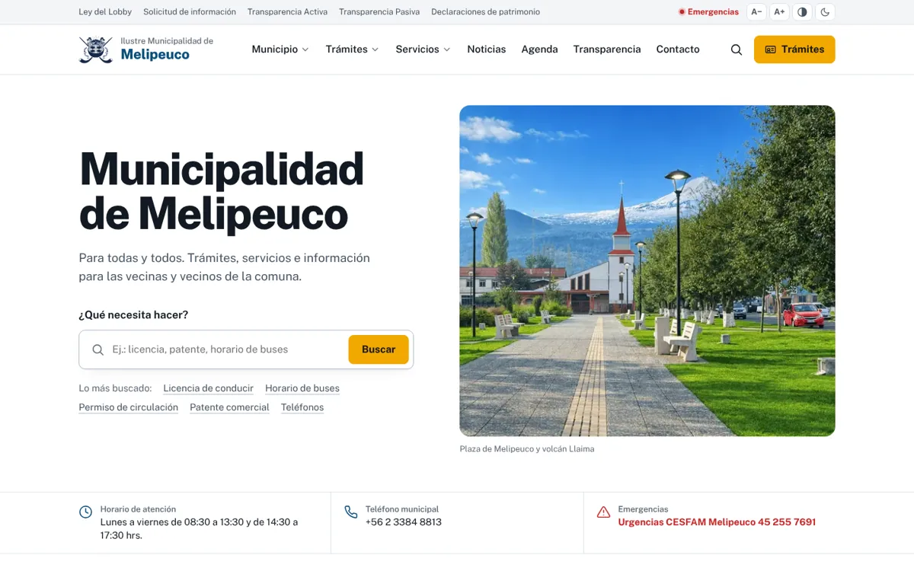
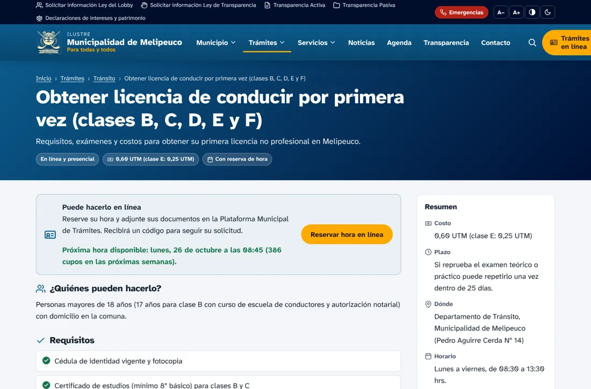
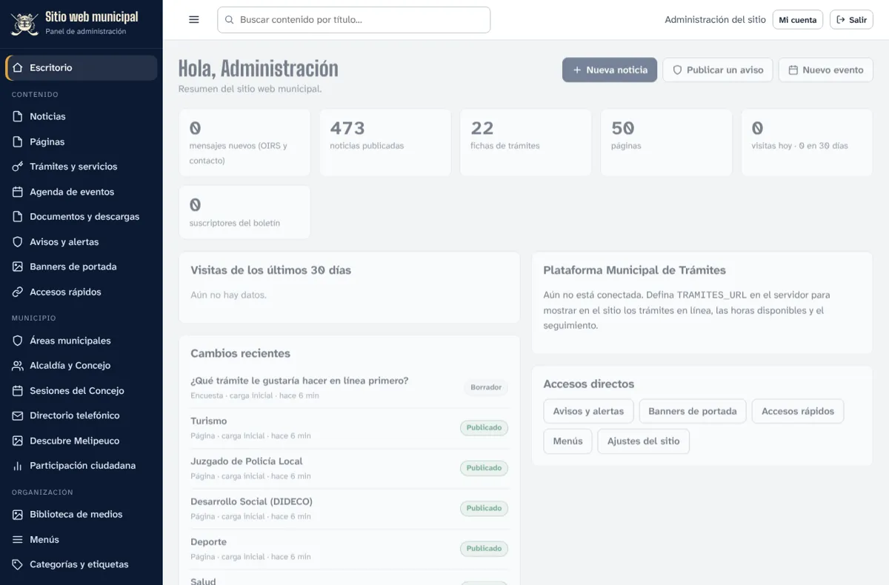
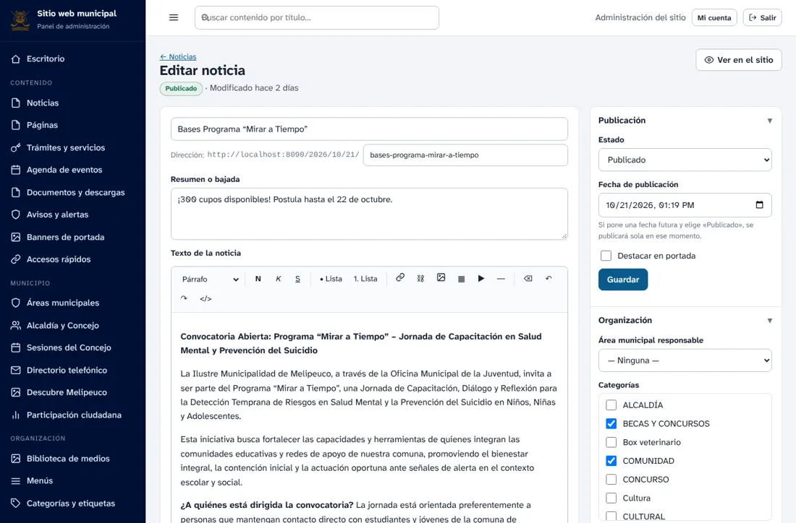
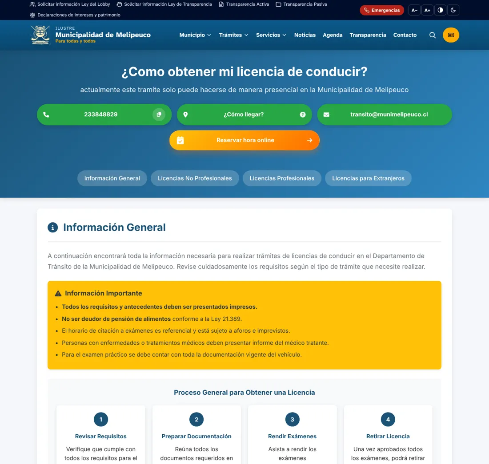
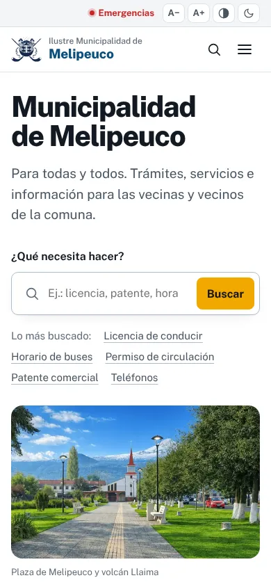

# Sitio web — Ilustre Municipalidad de Melipeuco

Nuevo sitio web oficial de la Municipalidad de Melipeuco («Para todas y todos»): réplica completa y mejorada de `municipalidadmelipeuco.cl`, con **panel de administración propio**, **seguridad reforzada** y **integración nativa con la Plataforma Municipal de Trámites** (proyecto `Transito`), para que todo trámite que se publique allí aparezca solo en el sitio.

| Portada | Ficha de trámite conectada a la Plataforma |
|---|---|
|  |  |
| **Panel: escritorio** | **Panel: editor de contenidos** |
|  |  |
| **Página heredada, idéntica a la original** | **Celular** |
|  |  |

## Qué incluye

**Todo el contenido del sitio actual**, importado desde WordPress y con las mismas direcciones:
- 473 noticias con sus fechas, categorías, etiquetas e imágenes (`/2026/10/21/bases-programa-mirar-a-tiempo/` sigue funcionando);
- 50 páginas (licencias, patentes, solicitudes, Juzgado, transporte, Fondeve, organigrama, Descubre Melipeuco…). Las páginas armadas con HTML a medida en Elementor se conservan **idénticas**, en un marco aislado y seguro;
- 59 eventos de la agenda, 1.789 archivos de la biblioteca de medios, 50 transmisiones del Concejo convertidas en sesiones, y el directorio telefónico y de correos;
- las páginas del menú que estaban vacías (Municipio, Salud, Educación, Udel, Social, Deporte, Turismo, Juzgado, PLADECO…) ahora tienen contenido: noticias de su área, trámites, contactos y documentos.

**Identidad «Melipeuco Capital del Trekking»** (diseño predeterminado, estilo *Capital del Trekking* en el panel)
- **Portada**: fotos de la Capital del Trekking que se funden con zoom lento, el logo de Melipeuco con sus nueve letras que caen una a una (luego aparecen los símbolos y el lema «Capital del Trekking», y las letras flotan y reaccionan al cursor), el buscador «¿Qué necesita hacer?» y la cordillera en capas con parallax. Los datos (horario, teléfono, tiempo, emergencias) flotan sobre la cordillera.
- **Las nueve letras del logo son la identidad de cada área**, con su color y su emblema: M montaña (Turismo), E rostro (Municipio), L cascada (Salud), I araucaria (Medio ambiente), P corazón (Desarrollo social), E persona (Trámites), U animales (Desarrollo local), C estrellas (Educación) y O kultrún (Cultura y agenda). Cada página interior toma el color y el emblema de su zona en el encabezado, que termina en una silueta de cordillera, y su título sube palabra por palabra.
- **«Cada letra de Melipeuco es una puerta»**: sección de la portada donde, al pasar o enfocar cada letra, el fondo toma su color y muestra el área del municipio.
- **Sección «Capital del Trekking»**: fila deslizable (flechas, arrastre o dedo) de volcanes, lagunas y saltos que llevan al sitio de turismo, y contadores animados (3 volcanes, 250 km de senderos, 44 rutas, 45 % de áreas protegidas).
- Cinta que desfila con las palabras del territorio, barra de progreso de lectura con los colores del logo, cabecera noche con línea arcoíris, accesos rápidos que se llenan de color en círculo, botones con relleno que sube, emblemas en el menú, tarjetas con zoom y brillo, botón «volver arriba» con anillo de avance y pie con la cordillera y el logo gigante.
- **Cortina de cordillera** al cambiar de página: suben capas de montaña con el color y el emblema de la sección de destino (se desactiva en *Diseño del sitio → Animaciones*).
- Tipografía de títulos Bricolage Grotesque (la del sitio de turismo), servida desde el propio sitio; el texto sigue en Public Sans.
- Los recursos de marca están en `public/img/trekking/` y las piezas del logo en `server/render/logo-trekking.json` (las mismas del sitio de la Capital del Trekking). El estilo *Institucional* del panel vuelve al diseño anterior.

- **Portada ordenada por prioridad**: héroe compacto → campañas municipales → trámites en línea → últimas noticias → accesos rápidos → agenda → Capital del Trekking → boletín. La cinta, «Cada letra es una puerta», áreas y video quedan disponibles (apagados) en *Ajustes → Portada*.
- **Qué trámites se ven en la portada**: en *Ajustes → Portada → Trámites en línea → Elegir trámites* se marcan y ordenan. Sin elección se muestran los marcados «Destacar en portada» o, si no hay, los primeros en línea.
- **Cabecera despejada**: menú de cinco entradas (Municipio, Trámites, Servicios, Noticias, Contacto; Agenda y Transparencia están dentro de Municipio) y las opciones de lectura (tamaño del texto, alto contraste, modo oscuro y emergencias) en un solo botón. La barra de transparencia y el botón «Trámites» se pueden volver a activar en *Diseño del sitio*.

- **Logo vivo** (el mismo del sitio de turismo, sin librerías: `public/js/logo-vivo.js`): las letras caen y cada símbolo cobra vida según lo que representa: el río fluye, el rostro parpadea y sonríe, las gotas de la cascada caen, la araucaria se mece, el corazón late, la persona camina, el gallo picotea y el caballo asiente, las estrellas titilan y el kultrún gira con ondas de sonido. Al pasar el cursor cada letra salta y hace su gesto.
- **Todo se personaliza en *Diseño del sitio*** con vista previa en vivo (botón «Animar el logo»):
  - *Portada*: animación del logo (vivo, caída, aparecer o ninguna), movimiento continuo y gestos de las letras, tamaño del logo, título, buscador, cordillera, puntos, zoom lento, intervalo y hasta cinco fotos propias para el carrusel, altura y oscurecimiento de la foto.
  - *Identidad Capital del Trekking*: color por área, emblema flotante, títulos palabra por palabra, barra arcoíris de lectura, línea arcoíris bajo la cabecera, cordilleras entre secciones, accesos con los nueve colores y velocidad de la cinta.
  - Estilos prediseñados nuevos: *Glaciar y lagunas* y *Pehuén y terracota*.
- **Contenidos de la identidad editables** en *Ajustes del sitio → Portada*: palabras de la cinta, los nueve mundos (nombre, texto y enlace de cada letra), los lugares de la Capital del Trekking (foto, etiqueta, texto, enlace y color) y las cifras con contador.

- **Interfaz v3**: un solo sistema de sombras en capas, radios y tiempos de animación para botones, enlaces, campos, tarjetas, listas y menús; cabecera blanca de vidrio; sin rayas decorativas. En *Diseño del sitio → Formas* se eligen las sombras (sin sombras, suaves o marcadas), los radios y los botones.
- **Portada «vitrina»** (predeterminada): insignia de la Municipalidad, logo vivo y buscador a un lado; al otro, el carrusel de fotos en un marco redondeado con un acceso flotante a la Capital del Trekking. Las fotos pueden ir a la derecha o a la izquierda. La portada de foto completa sigue disponible como «Capital del Trekking».
- **Encabezado de las páginas interiores** a elección: claro con el tono del área (predeterminado), oscuro con el color del área o simple.

- **Tamaño general de la interfaz** (*Diseño del sitio → Formas*): achica o agranda todo el sitio a la vez, de 80 % a 115 %.
- **Vercel con memoria compartida**: con una base Redis gratuita (Upstash, se conecta desde Vercel → Storage) los cambios del panel se guardan de forma permanente y llegan a todas las instancias. Ver [docs/DESPLIEGUE.md](docs/DESPLIEGUE.md#guardar-los-cambios-en-vercel-memoria-compartida-obligatorio-para-usar-el-panel).

- **Pantalla de carga «logo 3D»** (`public/js/transiciones.js`): el logo se reconstruye en el espacio. Las nueve letras llegan desde lejos girando en 3D, cada pieza de su símbolo cae desde delante y encaja, una ola de luz recorre las letras, se escribe «Capital del Trekking» y el logo vuela exactamente a su lugar en la portada. Se elige entre esta y la del escudo, y se ajusta la profundidad del 3D, en *Diseño del sitio → Animaciones*.
- **Transición entre páginas renovada**, con tres estilos: *columnas* (nueve paneles que giran en 3D, uno por letra), *portal* (el color del área se abre en círculo desde el clic, con el emblema que gira) y *cordillera*; en el color del área de destino o con los nueve colores del logo. Botón «Ver transición» en la vista previa.

- **Escudo municipal vivo** (`public/js/escudo-vivo.js`): en la cabecera las aves planean, las araucarias se mecen y el kultrún late; al pasar el cursor el volcán se levanta, el kultrún gira, las trutrucas suenan y los laureles se abren. En el pie el escudo se arma pieza por pieza al aparecer.
- **Pantalla de carga «escudo 3D»** (predeterminada): cada pieza del escudo es una capa en el espacio y entra según lo que es (el volcán como un telón, las araucarias girando, el kultrún como una moneda, las trutrucas cruzándose y sonando, los laureles como puertas, las aves volando, la cinta desplegándose) y el escudo vuela a la cabecera.
- **Versiones anteriores del diseño**: cada vez que se guarda, la versión anterior queda en *Diseño del sitio → Versiones anteriores* (las últimas 30), junto al diseño original y al institucional, para volver a cualquiera con un clic.

**Diseño (estilo Institucional)**
- Minimalista e institucional: blanco, tinta y el azul y ámbar de la marca municipal; menos cajas, líneas finas, más aire y una jerarquía tipográfica clara. Todo se puede cambiar desde *Diseño del sitio* en el panel.
- Portada «texto y foto lado a lado»: título grande, el buscador «¿Qué necesita hacer?» como protagonista y una fotografía real de Melipeuco (la plaza, la iglesia y el volcán Llaima). También está la composición con la foto de fondo.
- Franja con horario de atención, teléfono, tiempo actual y emergencias; accesos rápidos en una cuadrícula con divisiones de un pixel; listas de trámites, agenda y documentos sin marcos.
- Pie con el nombre de la comuna en letra gigante como firma.
- Una sola familia tipográfica, Public Sans, servida desde el propio sitio (sin depender de Google Fonts).
- Rápido: sin ilustraciones decorativas; la foto principal pesa entre 44 y 216 KB según la pantalla, y el HTML de la portada pesa unos 12 KB comprimido.
- Escudo municipal vectorizado (`public/img/escudo-*.svg`, `emblema-*.svg`).

**Movimiento** (API de animación nativa del navegador, sin librerías; se apaga con «reducir movimiento»)
- **Pantalla de carga** de la portada (primera visita de cada sesión, se salta con un clic o una tecla): el escudo se arma pieza por pieza. El volcán y el terreno se elevan, las araucarias crecen desde la raíz, el kultrún llega girando, las trutrucas se deslizan por su diagonal y suenan, los laureles con copihues brotan, las aves llegan volando y la cinta se despliega. Luego el escudo vuela al logo de la cabecera mientras la pantalla se cierra en un círculo sobre él. Las piezas salen de `public/img/escudo-piezas.svg`, generado desde el escudo con `herramientas/piezas-escudo.py`.
- **Entrada de la portada**: el título se descubre, la foto sube dentro de su marco y aparecen el buscador y el pie de foto.
- **Cabecera** que se oculta al bajar y reaparece apenas se sube; flechas que se deslizan en filas y mosaicos al pasar el cursor.
- **Aparición al desplazarse**: los accesos y las listas aparecen en cascada, las noticias descubren su foto, los títulos suben desde una máscara y la firma del pie se eleva. Todo dura menos de 0,7 s, salvo la firma.
- **Cursor**: el logo de la cabecera gira; la inclinación 3D de los mosaicos se puede activar en el panel.
- **Navegación**: barra de carga al cambiar de página y transición entre páginas con la cabecera fija (en navegadores compatibles).

**Mejoras del sitio público**
- Portada nueva: avisos de emergencia, foto de Melipeuco con buscador, horario y tiempo actual, campañas, buscador «¿Qué necesita hacer hoy?», accesos rápidos, trámites en línea con **próximas horas disponibles en vivo**, noticias, agenda, clima, teléfonos de emergencia, áreas municipales, turismo, encuesta, video y boletín.
- **Catálogo de trámites** con fichas claras (requisitos, documentos, paso a paso, costo, plazo, dónde y cuándo) y filtros por área y modalidad. Se mezclan las fichas del sitio y los trámites en línea de la Plataforma.
- **63 áreas municipales** según el Reglamento de Organización Interna N° 12/2025 (el mismo organigrama de la Plataforma), cada una con funciones, contacto, trámites y noticias.
- **Concejo Municipal**: autoridades, sesiones con tabla, acuerdos, acta y transmisión.
- **OIRS en línea**: consultas, reclamos y sugerencias con código de seguimiento; con RUN, el mensaje entra además como solicitud a la Oficina de Partes de la Plataforma.
- Agenda con calendario mensual y exportación a calendario (ICS), documentos por colección, transparencia, directorio con buscador, encuestas ciudadanas, boletín por correo, mapa del sitio.
- Buscador de texto completo con sugerencias al escribir (incluye los trámites en línea).
- **Accesibilidad**: contraste AA, tamaño de texto, alto contraste, modo oscuro, navegación con teclado, «saltar al contenido», textos alternativos, enlaces externos anunciados.
- SEO: metadatos, Open Graph, datos estructurados (organización, noticias, eventos, servicios), sitemap, RSS, URLs canónicas y redirecciones 301 de las direcciones antiguas.
- Rápido: páginas generadas en el servidor (5–15 ms), caché, compresión, imágenes en varios tamaños, videos livianos y aplicación instalable con lectura sin conexión.
- API pública de datos abiertos (`/api/public/`): noticias, avisos, eventos, trámites, áreas, documentos.

**Panel de administración** (`/admin/`)
- **Diseño del sitio con vista previa en vivo**: estilos prediseñados; colores, tipografía, formas, cabecera y logo, portada, pie y animaciones; CSS propio para el Super Administrador. Ver [docs/ADMINISTRACION.md](docs/ADMINISTRACION.md#diseño-del-sitio).
- Escritorio con mensajes pendientes, visitas, publicaciones programadas, cambios recientes y estado de la Plataforma.
- 14 tipos de contenido: noticias, páginas, trámites, eventos, documentos, avisos, banners, accesos rápidos, áreas, autoridades, sesiones del Concejo, directorio, lugares turísticos y encuestas. Cada uno con sus propios campos.
- Editor de texto enriquecido y **editor de bloques** (galerías, botones, tarjetas, preguntas frecuentes, videos, mapas, documentos, trámites en línea, formularios, directorio…).
- Borradores, revisión, publicación programada, historial de versiones con restauración, aviso de edición simultánea, vista previa, duplicar, SEO por contenido.
- Biblioteca de medios con subida por arrastre, optimización automática de fotos (WEBP en 480/960/1600 px) y control de usos.
- Menús, categorías, etiquetas y colecciones; ajustes del sitio (colores, contacto, redes, portada, emergencias, mantenimiento).
- Bandeja OIRS con estados, asignación, notas internas y respuesta por correo; boletín de noticias; estadísticas de visitas sin cookies; redirecciones; respaldos; exportación; importación desde WordPress.
- **Usuarios y roles**: Super Administrador, Administrador, Editor, Periodista, Encargado de área (sólo publica en sus áreas), OIRS y Consulta.

**Seguridad**: contraseñas con scrypt, sesiones con cookie `HttpOnly`/`SameSite=Strict`, token CSRF, verificación en dos pasos (TOTP), bloqueo por intentos, política de contraseñas, auditoría de todas las acciones, saneador de HTML por lista blanca, CSP con *nonce*, bloques HTML heredados en *sandbox* de origen opaco, validación del contenido real de los archivos subidos, límites de solicitudes y respaldos cifrados. Ver [docs/SEGURIDAD.md](docs/SEGURIDAD.md).

## Inicio rápido

Requiere **Node.js 22.5 o superior**. No tiene dependencias externas: no hay `npm install`.

```bash
cp .env.example .env     # complete PUBLIC_URL, ADMIN_EMAIL, ADMIN_PASSWORD y TRAMITES_URL
npm start                # http://localhost:8090  ·  panel: http://localhost:8090/admin/
npm test                 # pruebas automáticas
```

En el primer arranque se crea `data/sitio.db` con todo el contenido importado y el Super Administrador (si `ADMIN_PASSWORD` está vacío, la consola muestra una contraseña temporal).

## Documentación

- [docs/ADMINISTRACION.md](docs/ADMINISTRACION.md) — guía del panel para funcionarias y funcionarios.
- [docs/INTEGRACION-TRAMITES.md](docs/INTEGRACION-TRAMITES.md) — cómo se conecta con la Plataforma Municipal de Trámites y cómo agregar trámites nuevos.
- [docs/DESPLIEGUE.md](docs/DESPLIEGUE.md) — instalación en el servidor, nginx, HTTPS, respaldos y paso a producción.
- [docs/MIGRACION-WORDPRESS.md](docs/MIGRACION-WORDPRESS.md) — qué se importó, cómo se convirtió y cómo volver a importar.
- [docs/SEGURIDAD.md](docs/SEGURIDAD.md) — medidas de seguridad y recuperación de acceso.
- [docs/ARQUITECTURA.md](docs/ARQUITECTURA.md) — estructura del código y cómo extenderlo (tipos de contenido, bloques, rutas).

## Estructura

```
server/          servidor HTTP, base de datos, seguridad, API del panel, sitio público
  render/        plantillas HTML (portada, páginas, noticias, trámites, bloques…)
src/             esquema de tipos de contenido, roles y utilidades compartidas
public/          estilos, scripts, imágenes y el panel de administración (/admin/)
contenido/       semilla con el contenido importado del sitio actual
herramientas/    importador de WordPress, respaldos y recuperación de usuarios
tests/           pruebas automáticas (node:test)
docs/            documentación
```
